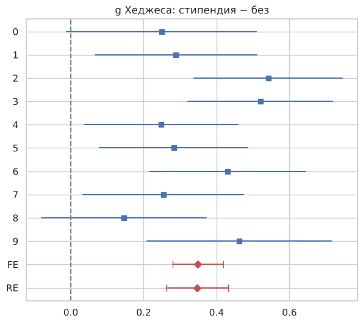
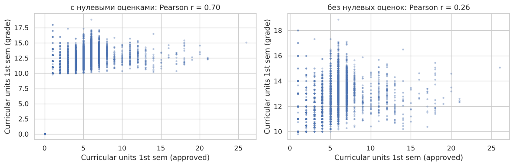

# Статистический анализ отчислений студентов

Исследую, какие факторы связаны с отчислением и успеваемостью студентов, и проверяю это статистическими методами: от разведочного анализа до мета-анализа по когортам.

**Стек:** Python · pandas · NumPy · SciPy · matplotlib · seaborn · Jupyter

**Данные:** [UCI — Predict Students' Dropout and Academic Success](https://archive.ics.uci.edu/dataset/697/predict+students+dropout+and+academic+success): 4 424 студента португальского вуза, 36 признаков (демография, социально-экономические факторы, успеваемость за 1-й и 2-й семестры, макроэкономика в год поступления) и итоговый статус: **Dropout** (32 %), **Enrolled** (18 %), **Graduate** (50 %).

## Главные результаты

| | Вопрос | Метод | Результат |
|---|---|---|---|
| 1 | Случайны ли пропуски в оценках? | Анализ скрытых пропусков | **Нет.** У 40 % отчисленных нет ни одной сданной дисциплины в 1-м семестре, у выпускников — 3,5 %. Удалять такие строки нельзя: выборка сместится в сторону успешных студентов |
| 2 | Отличается ли вступительный балл у выпускников и отчисленных? | $t$-тест Уэлча, ANOVA, критерий Тьюки | Да, у выпускников выше на 3,8 балла ($p < 10^{-13}$), но эффект слабый: **≈ 0,26 σ** |
| 3 | Успешнее ли стипендиаты в каждой когорте? | Мета-анализ по 10 когортам (FE / RE) | Да, во всех 10 когортах. $g$ Хеджеса **≈ 0,35** [0,26; 0,43], гетерогенность незначима ($I^2 = 34\,\%$) |
| 4 | Предсказывает ли вступительный балл оценку в 1-м семестре? | Мета-анализ корреляций (преобразование Фишера) | Умеренно: $r \approx 0{,}32$; связь заметно меняется между когортами ($I^2 = 54\,\%$) → модель со случайными эффектами |
| 5 | Влияют ли пол и стипендия на оценку? | Двухфакторный ANOVA (тип II, через МНК) | Оба фактора значимы, взаимодействия нет; эффекты малы — десятые доли балла из 20 |
| 6 | Насколько признаки дублируют друг друга? | Корреляции, фильтр по \|r\| > 0,8, PCA | Показатели семестров коррелируют на 0,90–0,94; 90 % дисперсии объясняют 10 компонент из 18 |

<p align="center">
  
</p>

*Forest plot: разница в числе сданных дисциплин 1-го семестра между стипендиатами и остальными ($g$ Хеджеса) по 10 когортам и объединённые оценки FE и RE.*

### Пример: почему нельзя слепо доверять корреляции



С нулевыми оценками (студенты без сданных дисциплин) коэффициент Пирсона равен 0,70, без них — 0,26. Высокое значение создаёт одна группа точек в (0, 0). На самом деле зависимость — «ступенька»: сдал хотя бы одну дисциплину → оценка 10–16 почти независимо от их числа.

## Что сделано

1. **Разведочный анализ.** Типы признаков, скрытые пропуски (0 вместо оценки), меры центра и разброса, выбросы по правилу Тьюки и когда это правило неинформативно (IQR = 0).
2. **ЗБЧ и ЦПТ.** Моделирование выборочных средних; сравнение эмпирических вероятностей отклонения с оценками Маркова, Чебышёва, Чернова и Хёфдинга.
3. **Корреляции и снижение размерности.** Пирсон, Спирмен и Кендалл; отбор признаков фильтром; **PCA, реализованный вручную** через собственные векторы ковариационной матрицы; сравнение двух подходов.
4. **Параметрические модели.** Нормальная, логнормальная и бернуллиевская модели, оценки ММП, проверка состоятельности, доверительные интервалы и их эмпирическое покрытие.
5. **Проверка гипотез.** Одно- и двухвыборочный $t$-тест.
6. **ANOVA и мета-анализ.** Однофакторный ANOVA с проверкой предпосылок (Шапиро, Левен), критерий Тьюки, двухфакторный ANOVA, мета-анализ по когортам с моделями фиксированных и случайных эффектов ($Q$, $T^2$, $I^2$, forest plot).
7. **Непараметрика.** ЭФР, доверительная полоса DKW, одно- и двухвыборочный критерии Колмогорова–Смирнова и сравнение с $t$-тестом.

Ключевые формулы (ЭФР, статистика КС, $g$ Хеджеса, модели FE/RE, двухфакторный ANOVA через МНК) реализованы вручную, а не только вызовом готовых функций.

## Как запустить

```bash
git clone https://github.com/<ваш-ник>/student-dropout-stats.git
cd student-dropout-stats
pip install -r requirements.txt
jupyter notebook student_dropout_analysis.ipynb
```

Датасет скачивается с сайта UCI автоматически при первом запуске. Можно положить `data.csv` из архива UCI рядом с ноутбуком — тогда он будет прочитан локально.

## Структура

```
├── student_dropout_analysis.ipynb   # весь анализ с выводами после каждого шага
├── images/                          # графики для README
├── requirements.txt
└── README.md
```

## Источник данных

Realinho, V., Vieira Martins, M., Machado, J., & Baptista, L. (2021). *Predict Students' Dropout and Academic Success* [Dataset]. UCI Machine Learning Repository. https://doi.org/10.24432/C5MC89 — лицензия CC BY 4.0.
